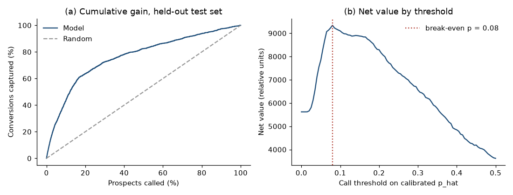

# term-deposit-conversion-roi

Who should the bank call? This repo scores term-deposit prospects with a logistic model, calibrates the probabilities, and picks a call list by expected value. It runs on **public data**: the UCI Bank Marketing dataset (id 222, `bank-additional-full.csv`, 41,188 rows, CC BY 4.0). The script downloads the file at run time, checks its SHA-256 and row count, and never commits it. Attribution is in [DATA.md](DATA.md). Costs and values are relative units (one call = 1, one conversion = 12.5), an assumption you can change in `src/policy.py`.



## Method

1. **Pre-call gate.** `PreCallFeatureGuard` rejects `duration`, the call length, which is only known after the call and is the dataset's well-known leak. It also rejects `campaign`, which counts the current contact.
2. **Model.** Class-weighted, L2-regularised logistic regression fitted by IRLS, on 28,832 training rows. The test set is a random 30% (12,356 rows, 11.64% subscribe).
3. **Platt calibration** fitted on 5-fold out-of-fold logits.
4. **Call-list policy.** With cost 1 and value 12.5, a call is worth making when calibrated p is at least 1/12.5 = 0.08. That threshold comes from the ratio, not from tuning on the test set.

## Results (random split)

| Check | Result |
| :--- | :--- |
| Test ROC-AUC, pre-call features | 0.7981 (PR-AUC 0.4699) |
| Test ROC-AUC with `duration` added | 0.9362 |
| Expected calibration error, before and after Platt | 8.42% to 1.07% |
| Brier score, before and after Platt | 0.0886 to 0.0797 |

| Policy | Calls | Capture | Precision | Net value | ROI % | Net-value index |
| :--- | ---: | ---: | ---: | ---: | ---: | ---: |
| Call everyone | 12,356 | 100.0% | 11.64% | 5,619 | 45.5 | 100 |
| Naive cutoff, p >= 0.50 | 478 | 22.8% | 68.62% | 3,622 | 757.7 | 64 |
| Break-even, p >= 0.08 | 3,659 | 72.3% | 28.42% | 9,341 | 255.3 | 166 |
| Top 30% by p | 3,707 | 72.5% | 28.11% | 9,318 | 251.4 | 166 |

ROI % is net value divided by calls placed. The net-value index is net value relative to calling everyone (= 100). They rank the policies differently: the naive cutoff has the highest ROI because it calls few people, and the lowest net value because it leaves most conversions uncalled.

## Where it breaks: a time-ordered split

The file is in date order (the calls span 2008 to 2010). Training on the first 70% of rows and testing on the last 30% gives a different picture, and the last 30% subscribes at more than twice the overall rate.

| | Random split | Time-ordered split |
| :--- | ---: | ---: |
| Test base rate | 11.64% | 24.55% |
| ROC-AUC, pre-call | 0.7981 | 0.6607 |
| ECE after Platt | 1.07% | 12.33% |
| Break-even net-value index | 166 | 79 |

Under the time-ordered split the model ranks worse, the calibration no longer holds, and the break-even list does worse than calling everyone. The macro columns (`euribor3m`, `nr.employed` and similar) also tie each row to a date, so a random split flatters the model. Read the random-split numbers as an upper bound.

## Run it

```bash
python -m venv .venv && source .venv/bin/activate
pip install -r requirements.txt pytest
python src/run_pipeline.py   # downloads and verifies the data, writes data/processed/ and the figure
pytest -q                    # 9 tests; most need the download
```

`data/` is gitignored. Only the figure is committed. CI runs ruff and pytest on Python 3.11 to 3.13. MIT licensed.
